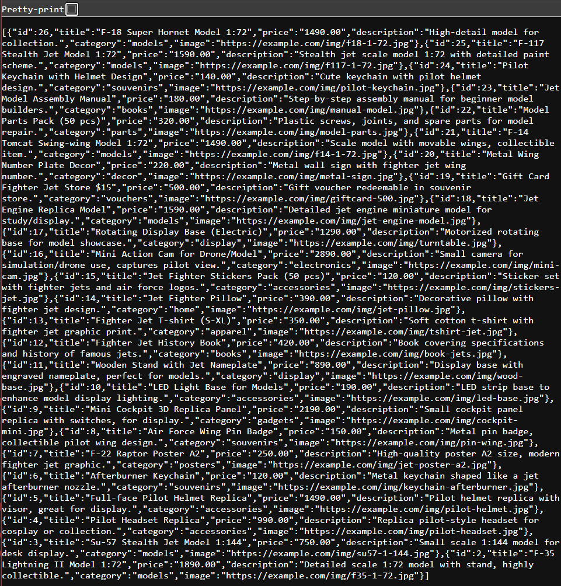

# Product REST API — Node.js + MySQL

**A CRUD REST API for a catalogue of 25 fighter-jet model products, built with Express and a MySQL connection pool, with input validation and parameterised queries.**


> **Lab 10: Web API with Node.js and MySQL.**

## API

| Method | Endpoint | Description |
|---|---|---|
| `GET` | `/products` | List all products |
| `GET` | `/products/:id` | Get one product (`404` if missing) |
| `POST` | `/products` | Create (`title` and `price ≥ 0` required) → `201` |
| `PUT` | `/products/:id` | Replace a product → `404` if missing |
| `DELETE` | `/products/:id` | Delete → `404` if missing |

- **SQL injection safe:** every query uses `?` placeholders through `mysql2`
- **Connection pooling** with `mysql2/promise`; configuration from `.env`
- **Consistent errors:** `400` for invalid input, `404` for missing rows, `500` without internal details in production

| Create (POST) | List (GET) |
|---|---|
|  |  |

## Run

Requires Node.js and MySQL (for example via XAMPP).

```bash
git clone https://github.com/tawan230666/Lab10-WebAPI-Node.git
cd Lab10-WebAPI-Node
npm install
cp .env.example .env               # adjust DB credentials
# Import database.sql in phpMyAdmin (or: mysql -u root < database.sql)
npm run dev                        # http://localhost:3000
```

Import `Lab10-WebAPI.postman_collection.json` into Postman to run every request.

---

**Author:** Tawan Tiphkun (ธาวัน ทิพคุณ), [@tawan230666](https://github.com/tawan230666), Software Engineering, RMUTL Chiang Mai
